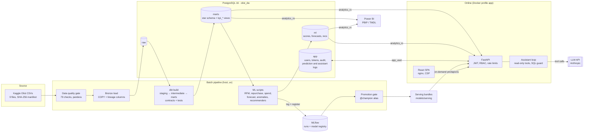
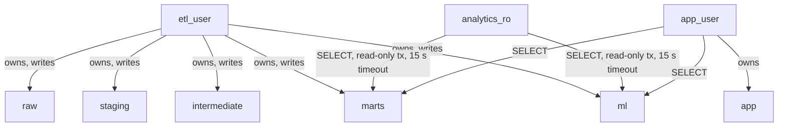
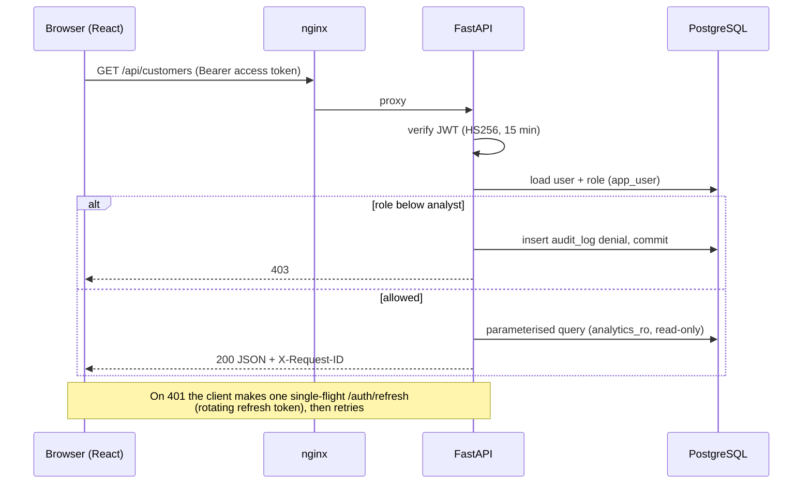
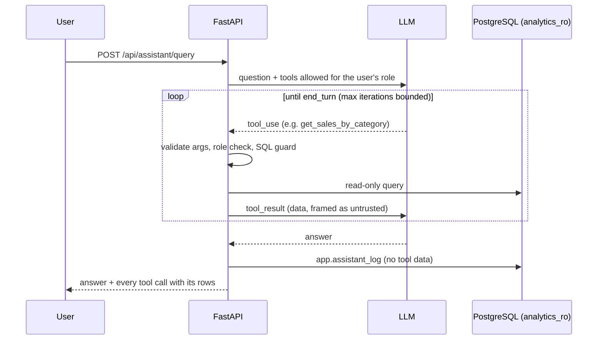

# Architecture

The platform is a batch analytics stack with an online serving layer. Data moves once, in
order: CSV → `raw` → dbt (`staging` → `intermediate` → `marts`) → ML scripts (`ml`). The API,
Power BI and the AI assistant only **read** the warehouse; the API writes only its own `app`
schema (users, tokens, logs).

## Components

| Layer | Technology | Responsibility | Docs |
|---|---|---|---|
| Ingestion | Python, pandera, psycopg `COPY` | Download, hash check, 79-check quality gate, bronze load with lineage | [etl_bronze.md](etl_bronze.md), [data_quality_report.md](data_quality_report.md) |
| Transformation | dbt-postgres | Cleaning rules (BR-01…), star schema with enforced contracts, incremental daily aggregate, KPI views | [star_schema.md](star_schema.md), [business_rules.md](business_rules.md) |
| BI | Power BI (PBIP/TMDL), DAX | Semantic model over `marts`, measures reconciled to SQL | [kpi_dictionary.md](kpi_dictionary.md), [report spec](../powerbi/documentation/report_spec.md) |
| ML | scikit-learn, XGBoost, Prophet, statsmodels, TensorFlow, MLflow | Point-in-time training sets, baselines, confidence intervals, batch scoring into `ml.*`, model registry | [model cards](model_cards/) |
| API | FastAPI, SQLAlchemy, Alembic, slowapi | Auth, RBAC, pagination, on-demand predictions, audit | [api.md](api.md) |
| Frontend | React 19, React Router, Vite, Tailwind, Recharts | 14 pages, role-gated navigation | [frontend.md](frontend.md) |
| Assistant | Anthropic SDK (LLM), sqlglot | Tool-grounded answers; tools-only mode without a key | [assistant.md](assistant.md) |
| Delivery | Docker, compose, GitHub Actions | Images, security scans, CI | [deployment.md](deployment.md), [security.md](security.md) |

## Database roles and schemas

Least privilege is enforced in PostgreSQL, not only in code: the assistant and Power BI use
`analytics_ro`, so even a SQL guard bypass could not write or read `app`.

## Request flow (authenticated page)

## Assistant flow

## Key design decisions

| Decision | Why | Trade-off |
|---|---|---|
| ELT with dbt in PostgreSQL | Transformations are SQL, tested, documented and versioned; one engine for BI, API and ML | Not suited to data far larger than one server |
| Natural keys in the star schema | Olist ids are stable hashes; simpler Power BI relationships and API lookups | Wider keys than integer surrogates |
| Analysis window 2017-01-01 → 2018-08-21 | 2016 and Sep–Oct 2018 are sparse or truncated (BR-02) | ~20 months of history, one Black Friday |
| Point-in-time ML snapshots, chronological splits | Prevents leakage of future orders, deliveries or reviews | Fewer training rows |
| Every model compared with a simple baseline, with CIs | Shows whether ML adds value; several models do not beat rules | Less flattering headline metrics |
| Batch scores in `ml.*`, on-demand models from MLflow | Fast reads for pages; consistent versions via the `champion` alias | Re-score after each promotion (checked by a test) |
| Serving bundles for containers | The registry stores absolute host paths | Extra export step |
| Assistant uses tools, not free SQL by default | Answers are grounded in the same queries as the dashboards | Questions outside the tool set need the analyst-only guarded SQL tool |
| Native PostgreSQL in development, Docker for the app stack | Docker was not available on the development machine | Images are built only in CI (not yet run) |
