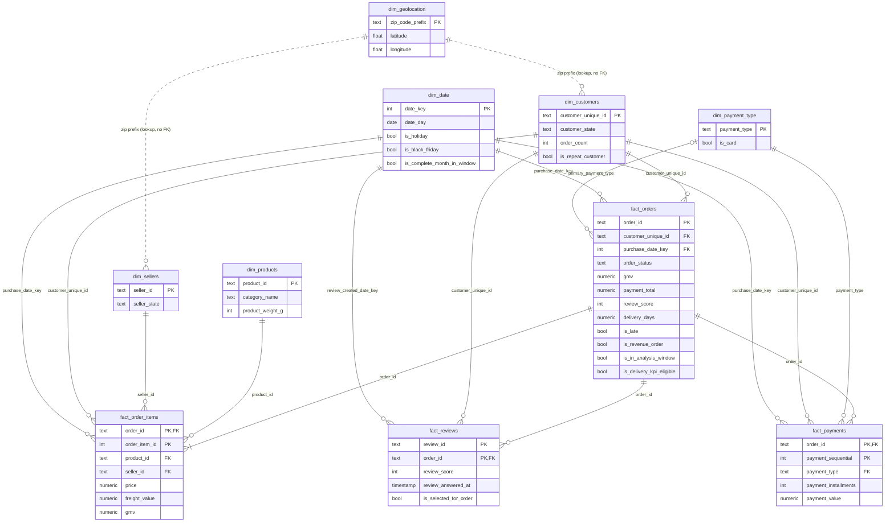

# Warehouse and star schema (dbt)

dbt project: [`warehouse/dbt`](../warehouse/dbt). It builds the silver and gold layers on top
of the bronze `raw` schema ([etl_bronze.md](etl_bronze.md)). Business rules are passed in as dbt
vars that mirror [`config/business_rules.yaml`](../config/business_rules.yaml); a test fails if
they diverge. Rationale for each rule: [business_rules.md](business_rules.md).

```bash
uv sync --group dbt
uv run --group dbt python -m data_engineering.scripts.run_dbt build          # models + 70 tests
uv run --group dbt python -m data_engineering.scripts.run_dbt docs generate  # catalog + lineage
uv run --group dbt python -m data_engineering.scripts.run_dbt docs serve
```

`run_dbt` loads credentials from `.env` and points dbt at `warehouse/dbt`. It runs as
`etl_user`.

## Layers

| Layer | Schema | Materialization | Models | Purpose |
|---|---|---|---|---|
| Silver | `staging` | view | 9 `stg_*` + 3 seeds | Types, renames, code mapping, row-level flags. One per source; **no row dropped** (row-count tests) |
| Intermediate | `intermediate` | table | 6 `int_*` | Per-order item, payment and review totals, so facts never fan out; enriched orders with all flags; zip-level geolocation; customer profile |
| Gold | `marts` | table (+1 incremental) | 6 `dim_*`, 4 `fact_*`, `agg_daily_sales` | Star schema for BI, ML and the API. `SELECT` granted to `analytics_reader` |

## Star schema



`dim_geolocation` is a lookup only: 278 customer rows and 7 seller rows have zip prefixes with
no coordinates, so an enforced FK would reject real customers. Their coordinates are copied into
`dim_customers` and `dim_sellers` and are NULL when unknown.

## Fact grains and how to aggregate without double counting

| Fact | Grain | Rows (full extract) | Use it for | Never |
|---|---|---|---|---|
| `fact_orders` | one order | 99,441 | order counts, GMV, AOV, payments total, delivery, review score per order | — |
| `fact_order_items` | one unit sold | 112,650 | revenue by product, category, seller | sum payments here |
| `fact_payments` | one payment line | 103,886 | payment mix, installments | join to items |
| `fact_reviews` | (review_id, order_id) | 99,224 | review text, all reviews | average scores without `is_selected_for_order` |

These dbt tests enforce the rules above:
- `sums_match`: Σ item GMV = Σ order GMV (15,843,553.24), and Σ payment lines = Σ order
  payment totals (16,008,872.12).
- `row_count_matches`: every fact has as many rows as its bronze source.
- One selected review per reviewed order.
- `agg_daily_sales` covers each of the 598 window days once and equals `fact_orders`.

KPI filters: revenue KPIs use `is_revenue_order AND is_in_analysis_window`. Delivery KPIs use
`is_delivery_kpi_eligible AND is_in_analysis_window`. Regional KPIs use
`customer_state_at_order`.

## Keys, constraints and indexes

- **Natural keys.** Olist IDs are stable 32-char hashes, so surrogate keys add nothing here.
  `date_key` is `YYYYMMDD`.
- **Enforced dbt contracts** on all 10 star models: declared column types, plus `PRIMARY KEY`
  and `FOREIGN KEY` constraints created in PostgreSQL (15 FKs).
  `assert_mart_foreign_keys_exist` checks that they exist.
- **Caveat (verified).** dbt replaces a table with `DROP … CASCADE`, so rebuilding only a
  dimension drops the FKs that point at it. Always rebuild downstream: `--select dim_x+`.
  The FK test fails if this is forgotten.
- **Indexes** on fact foreign keys (`customer_unique_id`, `purchase_date_key`, `product_id`,
  `seller_id`, `payment_type`) and on common filters (`customer_state`, `category_name`).
  Primary keys are indexed automatically.

## Incremental model

`agg_daily_sales` is `delete+insert` on `date_day`. Each run reprocesses
`incremental_lookback_days` (7) before the latest built day; the verified incremental run
reinserted 8 days. The extract is static, so this demonstrates the pattern (late-arriving
updates within a lookback window). `--full-refresh` rebuilds all 598 days.

## Verification (full extract, 2026-11-05)

- `dbt build`: 99 / 99 pass (29 models and seeds, 70 data tests) in about 75 s.
- The marts match the independent Python implementation of Phase 2 exactly:
  - GMV by status
  - late rate 6.7842% on all-date delivered orders
  - payment and item totals
  - 2,997 repeat customers
  - selected review score for all 98,673 reviewed orders
- Headline values in the analysis window, as defined by the rules:
  - GMV R$ 15,595,580.13 over 97,222 revenue orders, so AOV is R$ 160.41
  - 87,525 delivery-eligible orders: late rate 6.91%, median 10.80 days
- `tests/test_dbt_build.py` repeats `dbt build` on the sample fixture in isolated `test_*`
  schemas and checks parity with Python.
